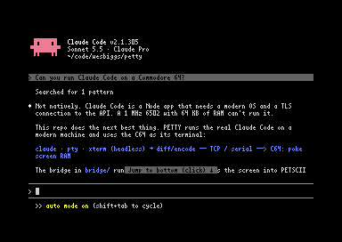
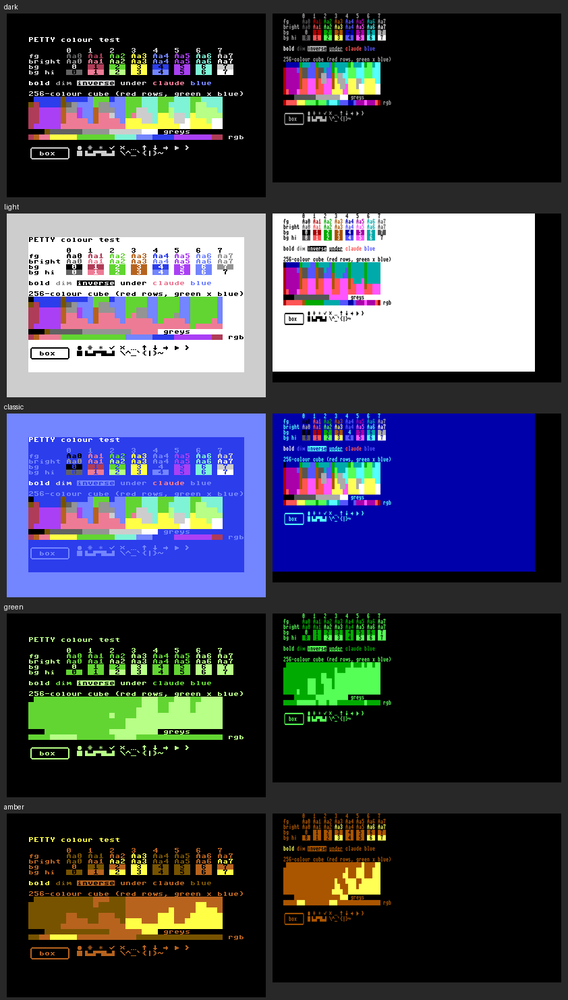
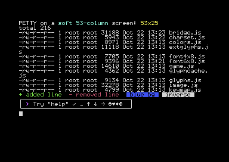
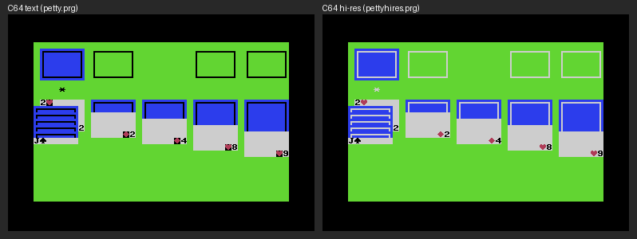

# PETTY

A Commodore 64 terminal (PETSCII + TTY) for Claude Code or any other terminal
program. There are also 80-column clients: one for the C128's 80-column
screen, and one for the C64 that draws 80 columns in the hi-res bitmap. A
third C64 client draws 53 columns in the hi-res bitmap, with a 6-pixel font
that is easier to read than the 80-column one's. A fourth draws 40 columns in
the hi-res bitmap, for colours per cell and several hundred more glyphs,
which the C128 client has too. One more C64 program has all four of the C64's
screens, and the bridge switches between them: see
[Switching screens](#switching-screens-the-combined-c64-client).

A bridge on a Mac or Linux host runs the program in a pty the size of the
client's screen (40×25, 53×25 or 80×25) and emulates the terminal headlessly
(`@xterm/headless`). It sends the C64 only the screen cells that changed,
already converted to C64 screen codes and colours. The C64 client (1.3 KB of
6502) just copies them into screen RAM and sends key presses back.



Want AI on your C64? PETTY runs the real Claude Code
CLI. And unlike on-C64 VT100 terminals (CBterm, GTERM), no escape sequences are
parsed on the C64, so it shows anything xterm can.

```
claude ⇄ pty ⇄ xterm (headless) → diff/encode ══ TCP / serial ══► C64: poke screen RAM
                    ▲                                               │
                    └──────────── keymap ◄═══ raw key matrix codes ═┘
```

## Requirements

- macOS or Linux (on Windows, use WSL); cc65 (`ca65`, `ld65`), VICE 3.x (`x64sc`, `x128`), Node 20+
- On real hardware: a SwiftLink-compatible cartridge (6551 ACIA at `$DE00`, NMI),
  wired to the host by a USB-serial adapter or through a WiFi modem (see
  [Real hardware](#real-hardware))

## Using a release

Each [release](https://github.com/wesbiggs/petty/releases) has the clients and the bridge as separate files:

- `petty-vX.Y.Z.d64`, `petty-vX.Y.Z-prg.zip` and the loose `.prg` files are the C64 and C128 clients (no `make` or cc65 needed).
- `petty-bridge-vX.Y.Z.tar.gz` is the bridge. It has no `node_modules`, because `node-pty` is a native addon that has to be built
  for your machine, so install the dependencies once (Node 20+, and a C/C++ toolchain if there is no prebuilt `node-pty` for your platform):

```bash
tar xzf petty-bridge-vX.Y.Z.tar.gz && cd petty-bridge-vX.Y.Z
npm ci --omit=dev
node src/bridge.js -- bash        # listens on 127.0.0.1:6464; add --port, --host, --serial as below
```

The commands in the rest of this README are written for a git checkout, where the bridge is in `bridge/`. In the release
tarball, drop that prefix: `node src/bridge.js`, `node scripts/petty-ctl.js`, `lib/pettygame.py`. There is no Makefile in
the tarball; the `make` targets only build the clients and start VICE.

## Run it in VICE

```bash
make                  # builds build/petty.prg, petty128.prg, petty80.prg, petty53.prg, pettyhires.prg and pettyall.prg (regenerates c64/*.inc)
make bridge           # terminal 1: listens on 127.0.0.1:6464, spawns your $SHELL on connect
make vice             # terminal 2: VICE with an emulated SwiftLink on TCP 6464
make vice128          # ...or a C128 in 80 columns: watch VICE's VDC window
make vice80           # ...or the C64 with the soft 80-column screen
make vice53           # ...or the C64 with the soft 53-column screen
make vicehires        # ...or the C64 with the 40-column hi-res screen
make viceall          # ...or the C64 with all four of those, switched by the bridge (C=+F3)
```

Start the bridge first, because VICE connects when the client enables the ACIA.
To run Claude Code directly: `make bridge CMD="-- claude"`, or
`node bridge/src/bridge.js [--port N | --serial DEV [--baud N]] [--host H] [--fps N] [--cols N] [--rows N] [--scroll N] [--theme T] [--mode SPEC] [--control N] [--title FILE] [--charset FILE] [--max-sessions N] [--idle-timeout S] [--on-exit restart|close] [--control-host H] [-v] -- <cmd> [args...]`.

When a client first connects, the bridge shows a start screen,
[bridge/title.ans](bridge/title.ans), for four seconds before it starts the
program; any key starts it sooner (and is not passed on). `--title FILE` shows
another file, `--title none` skips it. It is plain ANSI, so
`cat bridge/title.ans` shows it in any terminal too. Regenerate it with `make title`, which takes the version from
`bridge/package.json` (`make title VERSION=1.2.3` overrides it).

`--theme` sets the screen colour and the program's default colours: `dark`
(default: light grey on black), `light` (black on white), `classic` (the C64's
light blue on blue), or `green` / `amber` (monochrome monitors: every colour
becomes a shade of green or amber, by brightness). A program that asks the
terminal for its colours (OSC 10/11/4) gets the theme's, as shown on the
connected display; Claude Code picks light or dark this way.

The theme can be changed while the bridge runs: C=+F1 on the C64 switches to
the next theme (C=+F2, i.e. C=+SHIFT+F1, to the previous one), or from the host:

```bash
make theme T=amber    # or T=next / T=prev; no T shows the current theme
node bridge/scripts/petty-ctl.js [--port N] theme amber
```

`petty-ctl.js` talks to the bridge's control port, which listens on `--control-host`
(127.0.0.1: it can make the bridge play any file on the host) at `--port` + 1 (6465) unless `--control N` says otherwise. The screen is
redrawn in the new colours at once, but a program that asked for the colours
at startup keeps its answer until it restarts: Claude Code started on `dark`
keeps its dark-mode colours after a switch to `light`.



For programs that need a terminal wider than the client's screen, `--cols 80`
runs the pty at 80 columns and shows 40 of them at a time. C=+CRSR→ moves the
window right by 20 columns (0–39 → 20–59 → 40–79), and C=+SHIFT+CRSR→ moves it
left: `make bridge CMD="--cols 80 -- rogue"`.

Likewise `--rows 28` runs the pty at 28 rows and shows 25 of them.
CTRL+CRSR↓ moves the window down by up to half a screen, and
CTRL+SHIFT+CRSR↓ moves it up. Typing moves it to show the cursor's row.

C=+CRSR↓ and C=+CRSR↑ scroll the bridge's scrollback by one line per press;
`--scroll 3` makes it three, like a mouse wheel notch. A program that tracks
the mouse gets one wheel event per press instead, and decides how far to go.

On the C128 and the soft 80-column C64 the program gets an 80×25 terminal (53×25
on the soft 53-column C64), so it rarely needs `--cols`. Switching clients mid-session resizes the terminal.

If the program exits, press RETURN on the C64 to start it again. The session
survives C64 resets and reconnects; a reset just triggers a full redraw.

**RUN/STOP+RESTORE** restarts the client without a reset: it sets the screen, the
SID and the sprites up again, says hello to the bridge anew (which redraws
everything) and, in a client built with `DIAL`, hangs the modem up and dials again.
Use it when the link is out of step or a dial went nowhere. It does not work while a
sound plays (RUN/STOP stops that; then press it again). RESTORE alone does nothing.

## Keys

| C64 | Sends | Claude Code meaning |
|---|---|---|
| RUN/STOP or ← | Esc | interrupt, Esc Esc = rewind |
| SHIFT+RUN/STOP | Ctrl+C | clear input / quit |
| RETURN / SHIFT+RETURN | Enter / Meta+Enter | submit / newline |
| F1 / F3 | Shift+Tab / Tab | cycle mode / complete |
| F5 / F7 | Ctrl+R / Ctrl+O | history search / transcript |
| F2 / F4 | PgUp / PgDn | |
| C=+F1 / C=+F2 | next / previous theme | |
| C=+F3 / C=+F4 | next / previous screen, on the combined C64 client | |
| CRSR keys (+SHIFT) | arrows | |
| C=+CRSR↔ (+SHIFT) | pan right (left) by half a screen when `--cols` is wider than the screen | |
| CTRL+CRSR↕ (+SHIFT) | pan down (up) by half a screen when `--rows` is taller than the screen | |
| C=+CRSR↕ (+SHIFT) | scroll down (up), like a trackpad swipe: mouse wheel if the program tracks the mouse, else the bridge's 200-line scrollback | scroll |
| INST/DEL, SHIFT+INST | Backspace, Delete | |
| CLR/HOME, SHIFT+CLR | Home, Ctrl+L | redraw |
| CTRL+letter | control code | |
| C=+letter | Meta+letter | e.g. C=+P = model picker |
| £, SHIFT+£ | `\`, `\|` | |
| ↑, SHIFT+↑ | `^`, `~` | |
| SHIFT+: / SHIFT+; | `[` / `]` (C= gives `{` / `}`) | |
| SHIFT+@, SHIFT+- | `` ` ``, `_` | |

The soft 80- and 53-column and hi-res clients use the same keys. The C128 client sends them too,
plus:

| C128 | Sends |
|---|---|
| ESC | Esc |
| TAB, SHIFT+TAB | Tab, Shift+Tab (cycle mode in Claude Code) |
| ↑ ↓ ← → | arrows; with C=, scroll (↑↓) or pan (←→); with CTRL, pan (↑↓) |
| ALT+any key | Meta: Esc, then the key |
| LINE FEED | Ctrl+J (newline in Claude Code) |
| HELP | F1 |
| keypad | digits, `+ - .`, ENTER = Enter |

The mapping lives in [bridge/src/keymap.js](bridge/src/keymap.js).

## What each client can do

| | C64 text | C64 hi-res | C64 soft 80 | C64 soft 53 | C128 |
|---|---|---|---|---|---|
| Screen | 40×25 | 40×25 | 80×25 | 53×25 | 80×25 |
| Colours | one a cell, on the screen colour | foreground and background a cell | one per 2 cells (sprites repaint the rest) | one per 4 cells (likewise) | one a cell, on the screen colour |
| Extended glyphs (box drawing, braille, …) | aliased | yes | aliased | aliased | yes |
| Underline | no | yes | yes | yes | yes |
| Pictures in the terminal (`imgcat`) | blocks | pixels | pixels, in whole 8×8 cells | pixels, in whole 8×8 cells | pixels, a colour a cell on the screen colour |
| Full-screen pictures (`petty-view`) | yes | yes | yes | yes | no |
| Game hardware (sprites, MOVE, SID scripts) | yes | yes | yes | yes | no |
| Sound (`say`, `play`) | yes | yes | yes | yes | yes |

The combined C64 client ([below](#switching-screens-the-combined-c64-client)) can do what each of its screens can. The
gaps are the machines': the text screen has no bitmap for a picture's pixels; the soft screens' fonts are 4 and 6
pixels wide, too narrow for the 8×8 extended glyphs; and the C128's VDC has no sprites and no multicolour bitmap (its
SID could play the game's scripts, which is not done).

## How it maps the display

- **Characters:** the lowercase character ROM is copied to RAM at `$3800`, and
  41 custom glyphs are patched over the PETSCII graphics: missing ASCII
  (`\ ^ _ \` { | } ~`), box drawing, `⏺ ❯ ✻ ✓ … ↑ ↓ →`, card suits `♠ ♥ ♦ ♣`, and quadrant blocks
  for the logo. Codes 128–255 are the inverse of 0–127, so `█ ▐ ▄ ▛ ▜ ▙ ▟` cost
  nothing extra. Other Unicode is aliased or falls back to `?`. Edit
  [bridge/src/glyphs.js](bridge/src/glyphs.js); `make` regenerates `c64/glyphs.inc`.
  The C128 client uploads characters 0–127 to the VDC's font RAM, which holds
  512. The VDC reverses a cell with an attribute bit, so it needs no inverse
  copies, and the bridge loads the other 383 with extended glyphs, as on the
  hi-res C64 (below).
- **Colours:** ANSI 16 colours use a hand-tuned table per theme; 256-colour and
  truecolor use the nearest readable match in a Colodore-style palette. The C128's VDC has the ANSI
  colours themselves (RGBI), so they map one-to-one, except black and dark blue text.
- **Backgrounds:** text mode has no per-cell background. A cell with a coloured
  background is drawn as an inverse glyph (on the C128, a reversed cell) in that colour, so diff lines show as
  solid green or red bars, with text in the screen colour showing through. On
  the light theme, backgrounds only use colours dark enough for that white text.
- **Cursor:** drawn by the bridge as an inverse cell when the program shows it.
- **Soft 80 columns (C64):** the same screen codes drawn from a 4×8 font
  ([bridge/src/font4x8.js](bridge/src/font4x8.js), generated into
  `c64/font4x8.inc`) into the 320×200 hi-res bitmap. Letters are 3 pixels
  wide; `N`, `#`, lines and blocks use all 4. A bitmap cell holds two
  characters and one colour. When two visible characters of different
  colours share one, letters and digits keep the colour over punctuation (then
  the one with more lit pixels wins), and the loser is repainted in its own
  colour by a hardware sprite laid exactly over its pixels. Each 24×21 sprite
  covers the losers of one colour within 6 characters × 2 rows; there are 8,
  given to letters first, then to rows nearest the cursor. Anything beyond
  that keeps its neighbour's colour ([bridge/src/soft80.js](bridge/src/soft80.js)).
  `node bridge/scripts/mock-soft80.js out.ppm 1500 -- <cmd>` previews a
  program's screen, sprites included, without an emulator.
- **Soft 53 columns (C64):** the same idea with a 6×8 font
  ([bridge/src/font6x8.js](bridge/src/font6x8.js), generated into
  `c64/font6x8.inc`): 53 characters of 6 pixels make 318 of the bitmap's 320.
  Letters are 5 pixels wide and 7 tall (lowercase 5, with descenders), as in
  the C64's own font; lines and blocks use all 6. Four characters fill three
  8×8 cells, and the middle two straddle a cell boundary, so each group of four
  (columns 0–3, 4–7, …; column 52 alone) shares one colour: the colour with
  the most weight among its characters (letters and digits first, then lit
  pixels) keeps it, and sprites repaint the others as on the soft 80-column
  screen. A sprite is exactly 4 characters wide. The client builds its glyph
  tables, one per position in the group (12 KB), at startup.
  `node bridge/scripts/mock-soft80.js --53 out.ppm 1500 -- <cmd>` previews it.

  
- **Hi-res 40 columns (C64):** the text client's screen drawn into the hi-res
  bitmap, where each 8×8 cell has its own foreground and background. So
  backgrounds are real (black text on a white card, a red ♥ on it),
  underline is drawn on the bottom pixel row, and the
  character set needs no inverse half: codes 0–127 are the text client's, and
  the bridge loads 128–255 with glyphs the other clients only alias
  ([bridge/src/extglyphs.js](bridge/src/extglyphs.js)): heavy, double and dashed box
  drawing, eighth blocks and shades, braille (for graphs), arrows, shapes and
  a few symbols. It keeps up to 128 of them on screen at once (383 on the
  C128), reusing the least recently shown slot; past that, the rest fall back
  to their aliases ([bridge/src/glyphcache.js](bridge/src/glyphcache.js)). Scrolling moves the
  whole bitmap, which takes about 90 ms, as on the soft 80-column screen.

  
- **Pictures in the terminal:** inline images in iTerm2's format (OSC 1337, as
  sent by `imgcat`) are drawn in pixels on every client but the text one, which
  shows blocks of colour. iTerm2's own `imgcat` works;
  where there is none, the bridge puts a small one
  ([bridge/bin/imgcat](bridge/bin/imgcat)) at the end of the program's PATH:

  ```bash
  imgcat photo.png           # its own size, shrunk to fit the screen
  imgcat -W 20 logo.png      # 20 cells wide (also Npx, N%; -H for height)
  imgcat -t flat art.png     # never dither (-t dither: always)
  imgcat picture.dd          # Doodle! or Art Studio (.art): hi-res, pixel for pixel
  imgcat picture.koa         # Koala Painter: full screen, in multicolour
  imgcat -t koala photo.png  # any picture, converted to multicolour, full screen
  imgcat -t koala:flat x.png # ...never dithered (koala:dither: always)
  ```

  The bridge reads PNG and the C64's own picture formats, known by their file
  sizes. On the hi-res screen each 8×8 cell has two colours; a picture in
  the terminal gets the two that suit each cell best. Colours are matched in
  CIELAB, and a VIC colour matches itself: a hi-res picture (Doodle, Art
  Studio) comes out pixel for pixel. Flat art (32
  colours or fewer) isn't dithered: each colour maps to one VIC colour
  across the whole picture, keeping colours that look different apart where
  it can (the bands of a sunset), and a cell that needs more colours than it
  can have gives its least-used ones their next best match. Anything else,
  such as a photograph, is ordered-dithered where a mix of two colours comes
  closer than either. `-t flat` or `-t dither`, a type hint that iTerm2's
  imgcat passes on as it is, forces one or the other.

  A Koala picture is multicolour, which the text can't share the screen
  with: the client blanks the screen, switches to multicolour, loads the
  picture (about 10 KB) and shows it until a key is pressed. The key isn't
  passed on, and the bridge then redraws the terminal, which carried on
  meanwhile. `-t koala` (or `multicolour`) converts any picture this way,
  scaled to fill the screen in pixels twice as wide as they are tall, with
  four colours per 4×8 cell, one of them the background of the whole
  picture; `-t koala:flat` or `koala:dither` as above. Dithering has to do
  more good here, since patterns of double-width pixels show more.

  In the terminal, as in iTerm2, a picture starts at the cursor, and the
  cursor ends up after its last row. The terminal holds a private-use placeholder character for each
  of the picture's cells, so it scrolls, clears and is overwritten like text,
  and a redraw (a theme switch, a reconnect) draws it again. A whole
  screen is about 9 KB, sent 2 KB per frame: about 2.5 s at 38400 baud
  ([bridge/src/image.js](bridge/src/image.js)).

  On the soft 80- and 53-column screens a picture is whole 8×8 cells of the
  bitmap, each with its own two colours, as on the hi-res screen: 2 columns a
  cell at 80, 4 columns three cells at 53 (a picture is padded to whole groups
  and starts on one), sent with CELLS. Text written over part of a picture's
  cell takes that cell's colour. On the C128, whose VDC has one background for
  the whole screen, each 8×8 cell is a character of its own in the one colour
  that comes closest on the screen colour, twice as wide as on the C64 (the
  VDC's pixels are half as wide); identical cells share a character, and a
  picture has at most 300 cells, since they share the 383 loadable characters
  with the extended glyphs. Past those, cells are blocks. The text client shows
  a picture as blocks of colour, one per cell.

- **Full-screen pictures (`petty-view`):** on every C64 client, a picture can
  take the whole screen until a key is pressed (the key isn't passed on; the
  terminal carries on unseen, and is redrawn after). The pictures go to the
  VIC's second bank, where the bitmap screens keep theirs; the text client
  switches there and back, and sprites are hidden meanwhile.

  ```bash
  petty-view picture.koa          # Koala Painter: multicolour, as it is
  petty-view picture.art          # Art Studio, or Doodle! (.dd): hi-res, as it is
  petty-view photo.png            # anything else, converted to multicolour
  petty-view -t hires photo.png   # ...or to hi-res (two colours per 8×8 cell, on black)
  petty-view -t hires:flat x.png  # :flat or :dither as for imgcat
  ```

  On the C128, `petty-view` draws the picture in the terminal, as `imgcat`
  does. `imgcat` still shows Koala pictures and `-t koala` full screen.

  Many pictures are released as programs that unpack and show themselves
  (`…_exe.prg`). `prg2pic.js` runs one in VICE until a bitmap has been on
  screen for 2 s, then saves it from memory, where the VIC's registers say it
  is: multicolour as Koala, hi-res as Doodle. Raster tricks such as FLI or
  sprites laid over the bitmap are lost.

  ```bash
  node bridge/scripts/prg2pic.js picture_exe.prg      # writes picture_exe.koa (or .dd)
  ```

## Several clients at once

By default the bridge has one session: a client that connects takes it over, and it survives that client's reconnects.
`--max-sessions N` gives every TCP connection a session of its own (its own pty, terminal and program, with `PETTY_SESSION=id` in its environment),
for a program that serves several players:

```bash
node bridge/src/bridge.js --host 0.0.0.0 --title none --max-sessions 20 --idle-timeout 600 --on-exit close -- ./mygame
```

- A session ends when its connection does, and kills its program. A connection past N is closed at once, and logged.
  TCP keepalive is on, so a call that dropped without a goodbye still ends and frees its place.
- `--idle-timeout S` hangs up on a client that has pressed no key for S seconds (not while a sound plays). 0, the default, never.
- `--on-exit close` hangs up when the program exits (after the last screen is out), instead of waiting for RETURN to restart it.
- Each session has its own screen, display (a C64 and a C128 can play together), theme, pan position and sound queue.
  `--charset` and the other options are shared.
- The bridge runs whatever `--` names for anyone who connects, so name a program and not a shell, and add authentication in it.
  Run it as a user that can do little else.
- A serial line is always one session, so it can't be combined with `--max-sessions`.
- The control port takes `sessions` (list), and `@N` before a command picks a session: `@3 theme amber`, `@3 say hi`, `@3 kick`.
  Without `@N`, a command acts on the only session.

## Custom character set (the C64 text and hi-res clients)

`--charset FILE` redraws glyphs on the 40-column text and hi-res clients, to change the font or make tiles for a game. The file is JSON,
characters to glyphs; a glyph is 8 rows of 8 pixels, as `#` and `.` or as numbers 0-255:

```json
{
  "#": ["########", "#...#...", "########", "..#...#.", "########", "#...#...", "########", "..#...#."],
  "\uE000": { "slot": 200, "rows": [24, 60, 126, 255, 255, 126, 60, 24] }
}
```

A character with just rows gets a new picture in the screen code it already has (`#` above; so does everything that
aliases to it, such as `□`). A character with a `slot` is a new one, for a program to print.

- **Text client:** has no spare screen codes, so a new character takes over one of the 128 (0-127) that [glyphs.js](bridge/src/glyphs.js)
  uses. Pick one the program doesn't print: `✻` (112), `⏺` (109), the box corners and tees (97-108). The client makes 128-255 the inverse of 0-127
  when it starts, so the bridge POKEs each glyph and its inverse (a cursor or a coloured background shows it reversed): 64 glyphs are about 1 KB,
  0.3 s at 38400 baud. A `slot` of 128 or more is not for this client: the character shows as `?`.
- **Hi-res client:** loads glyphs with GLYPH, and has no inverse half to match (11 bytes a glyph). Slots 0-127 are as above. Slots 128-255 are the extended
  glyphs' (box drawing, braille, shapes), loaded as they appear on screen; a slot you give is kept out of that, so tiles there cost no
  text glyph, and the screen can show that many fewer extended glyphs at once. A character that has an extended glyph (`●`, `═`, braille) is
  redrawn by changing that, as are the characters that alias to it (`⬤`).
- **Soft 80- and 53-column and C128 clients:** not changed (4×8 and 6×8 bitmap fonts, and the VDC's own); a new character shows as `?`.

The glyphs are sent after each full redraw (a client start, a theme switch), so a reset restores them.

## Game hardware (the C64 clients)

A program that runs entirely on the host can use the C64 as its sprite chip and sound chip as well as its screen: it prints
escape sequences and the bridge turns them into C64 commands. **OSC 8348** is sprites, **OSC 8349** the SID. They work
on every C64 client; the C128 ignores them. On the soft 80- and 53-column screens the sprites a program uses are taken
from the 8 that repaint colours (which get the rest), and MOVE moves whole groups of columns (2 at 80 columns, 4 at 53). The parts are described at the top of
[bridge/src/game.js](bridge/src/game.js) (the sequences) and in [protocol.js](bridge/src/protocol.js) (the wire commands).
[bridge/lib/pettygame.py](bridge/lib/pettygame.py) prints them from Python, and
[bridge/examples/game-demo.py](bridge/examples/game-demo.py) is a small game (a hero walking over a scrolling map,
shooting arrows, with a tune): `make bridge CMD="-- python3 bridge/examples/game-demo.py"`, then `make vice`.

**Sprites.** Eight hardware sprites, 64 shapes kept in the C64 (`$2000-$2FFF` on the text client, `$4800-$57FF` on the others, and on
every screen of the combined client):

```
ESC ] 8348 ; def ; SLOT ; BASE64(63 bytes) BEL          a shape (24x21, 3 bytes a row)
ESC ] 8348 ; set ; N ; SLOT ; X ; Y ; COLOR [; xymb] BEL show sprite N; x wide, y tall, m multicolour, b behind the text
ESC ] 8348 ; glide ; N ; DX ; DY ; FRAMES BEL           the C64 moves it DX, DY pixels a video frame for FRAMES frames
ESC ] 8348 ; hide ; N BEL     ;  mc ; C1 ; C2 BEL      ;  sync ; TAG BEL
```

X and Y are pixels of the 320x200 text screen. Nothing is sent for a `set` that changes nothing, so a program can say where
everything is every frame. A glide is how a walk or a flying arrow costs one command rather than one per frame, over a link
that carries about 3.8 KB/s: it is ticked on the C64 by a raster interrupt, below the last text row, so it never tears. A `set`
at the place the glide ends is a no-op. `sync` asks to be told when the glides are over: the bridge writes
`ESC ] 8348 ; sync ; TAG BEL` to the program's input, which the C64 reports (and, if it does not, the time they should
take is up); `pettygame.Replies` takes these out of what you read from stdin. The sprites ride in the same frame as the screen's own
changes (after them), so a tile and the sprite on it change together. The bridge remembers the shapes and sprites and sends them again
to a client that restarts.

**The SID.** A script is a list of records, `[n, (register, value) * n, delay]`: write `n` registers, then wait `delay` frames.
A script is uploaded once and played by number on one of four channels, each with a mask of the registers its script may write,
so music on voices 1 and 2 and an effect on voice 3 cannot disturb each other. Scripts are played from the same interrupt, so
nothing is sent while a tune plays; time is in frames, so the tempo follows the machine (PAL or NTSC).

```
ESC ] 8349 ; def ; ID ; BASE64(script) BEL      n = 255 ends it, 254 loops (to the start, or the last 253), 253 marks the loop point
ESC ] 8349 ; play ; CH ; ID [; 1+2+3+f+vol] BEL start it on channel 0-3, where it may write (voices 1-3, the filter, the volume; default all)
ESC ] 8349 ; stop ; CH|all BEL   ;   w ; REG ; VAL [; REG ; VAL ...] BEL   ;   reset BEL
```

A `play` goes out at once, ahead of the next screen frame, so a footstep is not held up behind a redraw. Speech and `play`
(OSC 8347) still take the SID modally: the screen holds, the music stops, and the bridge starts any looping music again afterwards.

**Scrolling maps.** The bridge looks at each frame of a program that has used OSC 8348 or 8349 for a block of cells that moved a
few cells (a map as the camera follows the hero) and sends one `MOVE` (copy a rectangle, glyphs and colours, by up to 3 cells in
each direction) and the cells that are new, rather than the whole viewport again: about 150 bytes for a one-cell pan of 21x19 cells
instead of 2 KB. Vertical scrolls of the whole screen still use `SCROLL`.

`node bridge/scripts/vice-game-check.js` (or `make game-check`) runs the text client (`--display c64-hires`, `c64-80`, `c64-53`: the
others; `--all`: the combined client, switched to that screen) in VICE and checks all of this against the
emulated machine: shapes, positions, flags, glides across x = 256, random `MOVE`s against the reference decoder, and script timing and
masking in VICE's SID dump.

## Asking what you are drawing on (OSC 8350)

A program that draws differently for each PETTY client (the text client has 31 spare screen codes, the hi-res one 128 more
and a colour per cell) can ask:

```
ESC ] 8350 ; display BEL
```

and read back, on its input, `ESC ] 8350 ; display ; KEY ; COLS ; ROWS ; FLAGS BEL`. KEY is `c64`, `c64-hires`, `c64-80`, `c64-53` or `c128`;
FLAGS is a comma-separated list of `hires`, `ext`, `game`, `sound`, `reverse`, `pair`, `quad` (what the display can do, as in the sections
above; `pair` and `quad`: 2 or 4 neighbouring cells share a colour), `picture` (full-screen pictures) and `images` (`imgcat`'s pictures in
pixels). The answer waits for the client's HELLO, so asking as the program starts is fine: it comes when the client arrives, and
is never a guess. A bridge without this answers nothing, so a program should give up after a second or two.
`node bridge/scripts/ask-display.js` is a program that asks and prints the answer.

## Switching screens (the combined C64 client)

`build/pettyall.prg` is the text, hi-res, soft 53-column and soft 80-column clients in one program (about 11 KB), and the
bridge says which screen it should be on. The text screen draws fastest, the hi-res one has a colour per cell and
the extra glyphs, and the soft 53- and 80-column ones fit wider programs. The game hardware, pictures and the rest
work on each screen as in its own client. A switch clears the screen, resizes the program's terminal (the program gets a
SIGWINCH, and a shell rewraps its lines) and redraws it all: quick on the text screen, about a second at 80 columns.

The client starts on hi-res (`make START=c64-80`: another; `c64`, `c64-hires`, `c64-53` or `c64-80`). Then the
screen is chosen by, last word first:

- **A program,** with `ESC ] 8350 ; mode ; SPEC BEL`, until it sends `ESC ] 8350 ; mode ; restore BEL` or exits. It
  is answered as `display` is (above), once the client is on the new screen, so the program can wait for the answer and
  then draw at the new size. `restore` is not answered.
- **The user:** C=+F3 steps to the next screen, C=+F4 (C=+SHIFT+F3) to the previous one; or the control port,
  `node bridge/scripts/petty-ctl.js mode c64-80` (`mode next`, `mode prev`, `mode auto` to leave it to the client and
  programs, and `mode` alone shows the screen and the choices). Either takes back a program's request.
- **`--mode SPEC`** when the bridge starts.

SPEC is a comma-separated list of display keys (any of them), flags (all of them; see
[OSC 8350](#asking-what-you-are-drawing-on-osc-8350)) and a number (at least that many columns): `c64-80`, `game`,
`ext,game`, `80`. The client stays on its screen if that will do, and otherwise goes to the fastest that will (text,
hi-res, 53 columns, 80 columns): `game` on the hi-res screen stays there, and from 80 columns it goes to text.

`petty-mode` (on the program's PATH, after everything else) does it for programs that know nothing of PETTY:

```bash
petty-mode 80 rogue          # rogue on 80 columns, then back to what was there before
petty-mode game ./mygame     # a screen with sprites and the SID
petty-mode c64               # just switch, and print the display (KEY;COLS;ROWS;FLAGS)
```

The single-screen clients are still built (they are smaller, and leave more memory free), and they and the C128 client
don't switch: a request they can't meet is answered with the display they are on. On the wire the combined client says
`MODES` after its HELLO_ON, and the bridge sends `MODE` between frames (see [Protocol](#protocol)).

## Sound (the C64 and C128 clients)

A program in the terminal can speak, or play music, through the C64's SID, with `say` and `play`. The bridge
puts [bridge/bin/sound](bridge/bin/sound) first in the program's PATH (`--sound off` leaves it out), so inside PETTY these are the commands you get:

```bash
say "Build finished"             # speaks it; also: echo text | say, say -f notes.txt, say -v Fred hello
play song.mp3 other.wav          # any file ffmpeg reads
play -i song.mp3                 # sends the file itself, for a program on another host (over ssh this is automatic)
```

They ask the bridge with an escape sequence, **OSC 8347**, so they work over ssh too:
`ESC ] 8347 ; say ; <base64 text> [; voice=NAME] BEL`, `play ; <base64 path>` (a file on the bridge's host),
`data ; <base64 file contents>` (a file sent inline), and `stop` (drops what is queued). A program that cannot run a
script can print the sequence itself. [bridge/src/sound/manager.js](bridge/src/sound/manager.js) reads them and queues
the sounds. The speech is made by `--tts 'piper -m voice.onnx -f {out}'` (any program
that reads text on its standard input and writes a WAV to `{out}`, or to its standard output if there is no `{out}`); without `--tts`, by macOS `say`, or on a host
without it by `espeak-ng` or `espeak` if installed (`say -v NAME` passes the voice to either), and otherwise `say` reports an error that names `--tts`; files are decoded with ffmpeg, in a worker thread, so the terminal carries on meanwhile.

It plays **modally**: the client's screen stays on, still, while the sound plays, and whatever the program prints meanwhile is held in the
bridge and drawn when the sound ends. RUN/STOP on the C64 stops the sound and drops the queue (stop means stop; the bridge cannot stop a sound that has started,
because the C64 is not listening for commands while it plays).

How it works is in [petty-d418](https://github.com/wesbiggs/petty-d418), which this is a port of. The bridge turns the audio into 2-bit codes
(an adaptive delta code found by a Viterbi search, with the noise pushed down in frequency under the signal: `--sound-weight -0.6`),
and streams them at about 2 KB/s of the link's 3.8; the C64 plays them by writing the SID's volume register 7.8 thousand times a second
(a sample every two raster lines), polling the serial link in the same loop. A flow-control byte
for each byte taken keeps the C64's 256-byte buffer from overflowing, as a SwiftLink has no handshake. Three SID voices are held at a DC level so the volume steps have
something to scale. The bridge asks the client what machine it is when it says hello (PAL or NTSC, from the length of a video frame) and times the samples to match.
The client's code is [c64/sound.inc](c64/sound.inc), included by all five clients: text, soft 80- and 53-column, hi-res and C128 (each
supplies `RX_PENDING`, a macro that tests its receive ring, and POKE, which loads the tables). Each plays modally, and
scored 9-10 dB speech-band SNR against the speech in VICE (old CIA, PAL). The text, soft 80 and 53 and hi-res clients keep the
display on and lock the samples to the raster. The C128 client has nothing to lock to (its 40-column VIC is blank, the VDC
shows the screen), so it drops to 1 MHz, swaps every ROM for RAM so the buffer and tables can sit at $CD00-$CFFF,
puts an `rti` in the NMI and IRQ vectors for the while, and goes back to 2 MHz after. Its SID is usually an 8580:
`--sound-lut sid8580`. Sprites are switched off while a sound plays (their DMA would steal cycles).

The measurements and what was tried and dropped are in [docs/sound.md](docs/sound.md).

**Calibrating a real SID.** Chips differ, and the output tables are measured from VICE's. `make build/staircase.prg`
(also in the release) is a standalone program, not a client, that steps the volume through 0-15 and back for two seconds. Run it, record
the C64's audio output with a line-in (a microphone hears the room, and many recorders compress), and measure the recording:

```bash
node bridge/scripts/sound-calibrate.js recording.wav --json my-sid.json     # --ntsc on an NTSC machine
node bridge/src/bridge.js --sound-lut my-sid.json
```

The recording's gain does not matter, but a compressor or a clipped recording would. It prints how far its four measurements of each
step differ (a few percent when clean). The table is used only by the bridge: the C64 needs nothing new.

Things the port taught, which are in the code:
- **The tick is a counter, not a flag.** CIA 2's timer A sets the sample period and its timer B counts A's underflows; a sample starts when B changes.
  Polling the interrupt flag register (as petty-d418's first version did) loses ticks on the old 6526 CIA that breadbin C64s have, which VICE's
  `-model c64` emulates and its default `c64c` does not: the stream ran at a third of its speed.
- **The KERNAL's 60 Hz interrupt must be masked while the C64 polls the receiver** (it takes over a millisecond, and a byte comes every 260 µs): with it
  on, bytes were lost from the start of a sound.
- The timer is locked to the raster (the writes are a fixed distance from a raster line's start), so that with the display on a badline does not
  delay them. `--sound-delay N` moves it; the measurement is flat from 0 to 12 on VICE.

Measured in VICE (`node bridge/scripts/sound-capture.js`, which plays a sentence through the whole path and scores the recording): 15 dB speech-band SNR against what the encoder planned, and
9.5 dB against the speech itself (the 2-bit code and the noise weight cost the rest), on PAL and NTSC machines, with the old and the new CIA. Not tested: RUN/STOP, a real SwiftLink, a real machine,
and the soft 80- and 53-column and text clients.

Options: `--tts`, `--voice`, `--sound-weight`, `--sound-lut` (the SID's output table: `sid6581`, `sid8580`, or a JSON file measured from your machine, below), `--sound-delay`, `--sound-out FILE` (write what it played, to compare), `--sound off`.
The control port takes `say TEXT` and `play FILE` (`node bridge/scripts/petty-ctl.js say hello`).

## Protocol

See [bridge/src/protocol.js](bridge/src/protocol.js). Host→C64 opcodes are GOTO,
COLOR, PUT, REPEAT, SCROLL, COLORS, CLS and FRAME, plus SPRITE and NOSPRITE
(the colour-repairing sprites) and CELLS (a picture's bitmap cells) for the soft
80- and 53-column screens, GLYPH for the hi-res one and the C128, UNDERLINE for
the hi-res and soft screens, BITS (cells of a picture, as raw pixels) for the
hi-res one, VIEW (full-screen pictures, multicolour or hi-res) and POKE (to load
them) for every C64 client, the game hardware's (SPRDEF to SPRMC, see
[Game hardware](#game-hardware-the-c64-clients)) for every C64 client too, MODE
for the combined one, and SOUND and PROBE (see [Sound](#sound-the-c64-and-c128-clients)), which every client has.
Every frame ends with FRAME and
the C64 answers ACK. The bridge keeps only one frame in flight, so fast output
merges into fewer frames instead of overflowing the client's receive buffer (256
bytes; 4 KB on the bitmap C64 clients).
(The program-facing escape sequences, OSC 8347-8350, are not part of this wire protocol: they are between the program and the
bridge, and the bridge turns them into the commands above. OSC 8350 `display` needs none, and the client is unchanged.)
The combined C64 client sends `MODES mask` after its HELLO_ON (bit n set: it can show display n; bit 7 is always set,
so an older bridge skips both bytes), and the bridge may then send `MODE id` once no frame is in flight. The client
clears its screen, stops its sprites and SID scripts, and answers `HELLO_ON id` and MODES again; the bridge sends
nothing in between, then redraws everything. For a display it has no screen for, it answers with the one it is on.
C64→host messages are ACK, `KEY code mods` and HELLO (and, for sound, CREDIT, DONE, ABORT and PROBE). A client on another
display sends `HELLO_ON id` instead (1 = C128 VDC, 2 = C64 soft 80 columns,
both 80×25; 3 = C64 hi-res, 40×25; 4 = C64 soft 53 columns, 53×25), and the bridge
resizes the program's terminal to match. For the C128, colours are VDC
attribute bytes (bit 6 reverses the cell, bit 7 selects characters 256–511),
and key codes go up to 87 with ALT as modifier bit 3. For
the hi-res C64, a colour is foreground × 16 + background, and underline is
switched with UNDERLINE.

For each frame the encoder tries every full-screen scroll offset and picks the
cheapest encoding. A spinner tick costs about 7 bytes, and a full redraw about
700–1500 at 40 columns, or up to about 3000 at 80.

## Testing without a C64

```bash
cd bridge && npm test                                 # encoder vs reference decoder
node bridge/scripts/fake-c64.js 6464 $'echo hi\r'            # pretend C64: types keys, prints screen
node bridge/scripts/fake-c64.js --c128 6464 $'echo hi\r'     # same, as an 80-column C128
node bridge/scripts/fake-c64.js --soft80 6464 $'echo hi\r'   # same, as the soft 80-column C64
node bridge/scripts/fake-c64.js --soft53 6464 $'echo hi\r'   # same, as the soft 53-column C64
node bridge/scripts/fake-c64.js --hires 6464 $'echo hi\r'    # same, as the hi-res C64
node bridge/scripts/fake-c64.js --modes 6464 $'echo hi\r'    # same, switching screens as the combined C64 client does
node bridge/scripts/fake-c64.js --serial /dev/ttys005 0 $'echo hi\r'  # to a bridge on --serial
```

With VICE's `x64sc` on the PATH, three checks run the real clients in it, with a script for a bridge, and compare what
they did to the machine's memory:

```bash
make game-check      # sprites, glides, MOVE and SID scripts, on every C64 client and every screen of the combined one
make mode-check      # the combined client's screens, byte for byte against the single-screen clients'
make picture-check   # full-screen pictures, inline picture cells and underline, on every C64 client
```

To try the dial step in VICE, put a pretend WiFi modem between VICE and the
bridge: it answers AT commands and dials `ATDT host:port` over TCP.

```bash
make bridge                                  # terminal 1, on 6464
node bridge/scripts/fake-modem.js 6480       # terminal 2
make vice PORT=6480 DIAL=127.0.0.1:6464      # terminal 3: VICE talks to the modem
```

To see how colours and glyphs map, `cat colortest.ans` in a session (for
example `make bridge CMD="-- bash --norc"`). It fits on a 40×25 screen and
shows the 16 ANSI colours as text and backgrounds, attributes, the 256-colour
cube, a truecolor sweep and the custom glyphs. Regenerate it with
`node bridge/scripts/gen-colortest.js`. Screenshots:
[C64](docs/colortest-c64.png), [C128](docs/colortest-c128.png).

## Layout

| Path | What |
|---|---|
| `c64/main.s` | ca65 client: NMI serial receive, command decoder, keyboard scan |
| `c64/petty.cfg` | linker config (program must end below `$2000`) |
| `c64/main80.s` | soft 80-column C64 client: the same, drawing into the bitmap |
| `c64/petty80.cfg` | linker config (program must end below `$4000`) |
| `c64/main53.s` | soft 53-column C64 client: the same, with 6-pixel characters |
| `c64/petty53.cfg` | linker config (program must end below `$4000`) |
| `c64/mainhires.s` | hi-res 40-column C64 client |
| `c64/pettyhires.cfg` | linker config (program must end below `$4000`) |
| `c64/mainall.s` | the combined C64 client: the four files above, each assembled in a scope with `MULTI`, and what they share |
| `c64/pettyall.cfg` | linker config (program must end below `$4000`) |
| `c64/move.inc`, `movebits.inc` | MOVE, for every C64 client (the bitmap clients' rows in `movebits.inc`) |
| `c64/view.inc` | VIEW, full-screen pictures, for every C64 client |
| `c64/cells.inc` | CELLS, inline pictures in whole cells, for the soft 80- and 53-column clients |
| `bridge/bin/petty-view` | shows a picture full screen until a key is pressed |
| `bridge/scripts/vice-picture-check.js` | runs every C64 client in VICE and checks pictures, CELLS and underline there (`make picture-check`) |
| `bridge/scripts/vice.js` | the VICE harness the `vice-*-check.js` scripts share |
| `bridge/bin/petty-mode` | asks for a screen (OSC 8350 `mode`) around a command |
| `bridge/scripts/vice-mode-check.js` | runs the combined client in VICE and checks each screen against its own client's (`make mode-check`) |
| `c64/staircase.s` | standalone program for calibrating a real SID (`make build/staircase.prg`) |
| `c64/game.inc` | game hardware for the C64 clients: sprites, glides, MOVE, the SID script player (OSC 8348, 8349) |
| `bridge/src/game.js` | those OSCs: the program's sprites and scripts, kept for a client that restarts |
| `bridge/lib/pettygame.py` | prints them from Python; `bridge/examples/game-demo.py` is a small game |
| `bridge/scripts/vice-game-check.js` | runs a C64 client in VICE and checks the game hardware against the machine (`--display`, `--all`) |
| `c64/sound.inc` | sound for all the clients: SOUND and PROBE, the 2-bit decoder and the playback loop |
| `c128/main.s` | C128 client: the same, drawing on the VDC at 2 MHz |
| `c128/petty128.cfg` | linker config (program must end below `$3800`) |
| `c64/dial.inc` | the dial step, included by all five clients |
| `bridge/src/bridge.js` | TCP server or serial port, pty, frame pacing |
| `bridge/src/serial.js` | opens a serial device, raw at the given baud rate |
| `bridge/src/screen.js` | xterm buffer → screen codes/colours |
| `bridge/src/soft80.js` | soft 80 and 53 columns: shared cell colours and sprite repaints |
| `bridge/src/protocol.js` | encoder and reference decoder |
| `bridge/src/glyphs.js` / `colors.js` / `keymap.js` | character, colour, key mappings |
| `bridge/src/font4x8.js` | 4×8 font for the soft 80-column screen |
| `bridge/src/font6x8.js` | 6×8 font for the soft 53-column screen |
| `bridge/src/extglyphs.js` / `glyphcache.js` | the extra glyphs for the hi-res C64 and the C128, and which are loaded |
| `bridge/src/image.js` | inline images: OSC 1337, PNG and C64 pictures; hi-res, multicolour and C128 conversion |
| `bridge/bin/imgcat` | sends pictures as inline images, where iTerm2's imgcat isn't installed |
| `bridge/bin/sound/say`, `play` | speak and play on the C64, by OSC 8347 (first in the program's PATH) |
| `bridge/src/sound/` | sound: the OSC and queue (`manager.js`), the playback session, the codec, DSP, TTS and file loading |
| `bridge/scripts/sound-capture.js` | plays a sound in VICE through the whole path and scores the recording |
| `bridge/scripts/prg2pic.js` | saves the picture a self-showing `.prg` displays, as Koala or Doodle |
| `bridge/scripts/gen-glyphs.js` | writes `c64/glyphs.inc`, `c64/font4x8.inc` and `c64/font6x8.inc` |
| `bridge/scripts/fake-c64.js` | pretend client for testing without VICE |
| `c64/dialask.inc` | the dial's progress display and the setup screen with `PETTY.CFG` (`DIALDEBUG=1`, `DIALASK=1`), for all five clients |
| `bridge/scripts/fake-modem.js` | pretend WiFi modem for testing the dial step |
| `bridge/scripts/petty-ctl.js` | sends commands to the bridge's control port |
| `bridge/scripts/mock-soft80.js` | renders a program's soft 80-column (`--53`: 53-column) screen to an image |
| `bridge/scripts/gen-colortest.js` | writes `colortest.ans` |
| `bridge/scripts/ask-display.js` | asks the bridge which client it is drawing on (OSC 8350) and prints the answer |
| `bridge/scripts/gen-title.js` | writes `bridge/title.ans`, the start screen |

Every C64 client switches BASIC's ROM out (none of them returns to BASIC), and keeps the SID's scripts at `$9000–$9FFF`, the
game's variables at `$C000` and sound's tables at `$CD00–$CFFF`. A full-screen picture goes to the VIC's second bank on all
of them: bitmap `$6000–$7F3F`, colours `$5C00`, and colour RAM.

Text: code `$0801–$17C3`, sprite shapes `$2000–$2FFF`, receive ring `$3700`, character set `$3800–$3FFF`, screen `$0400`.

Hi-res 40 columns: code `$0801–$1A9C`; the VIC uses its second bank, with the
font `$4000–$47FF` (one page per pixel row), sprite shapes `$4800–$57FF`, colours `$5C00` and the bitmap
`$6000–$7F3F`; receive ring `$8000–$8FFF` (4 KB, because a bitmap scroll takes about 90 ms).

Soft 80 columns: code `$0801–$1EAD`; as the hi-res client, but the colour sprites' data at `$5800–$59FF`, and the
glyph tables at `$A000–$AFFF` (built at startup), under BASIC's ROM.

Soft 53 columns: code `$0801–$2157`; as the soft 80-column client, but six glyph tables of 2 KB, one for each part of a
cell a character can fall in: `$A000–$BFFF`, `$4000` (in the VIC's bank, which doesn't use it) and `$C100`.

Combined (`pettyall.prg`): code `$0801–$35B8` (`$3AFD` with `DIALASK=1`), with the character ROM's lowercase half copied
to `$0400–$07FF` once, at start (the screens build their fonts from it when they come on). Otherwise each screen's
memory is as in its own client, but the text screen, which is in the VIC's second bank too: screen `$5C00`, character set `$4000`.

C128 (bank 15): code `$1C01–$231F`, font build buffer `$3800–$3BFF` (startup
only), receive ring `$3F00`. VDC RAM: screen `$0000`, attributes `$0800`, font
`$2000–$3FFF` (512 characters; 128–511 loaded by the bridge).

## Real hardware

Two ways to reach the bridge from a SwiftLink:

- **Serial cable:** a USB-serial adapter on the host and a null-modem cable
  to the SwiftLink. The bridge opens the device instead of listening on TCP,
  and sets it to raw 8N1 with no flow control:

  ```bash
  make bridge CMD="--serial /dev/cu.usbserial-1420 -- claude"   # Linux: /dev/ttyUSB0
  ```

  `--baud` defaults to 38400: the SwiftLink's crystal doubles the 6551
  rates, so the clients' "19200" setting gives 38400. If the adapter is
  unplugged, or not there yet, the bridge keeps trying to open it. The
  control port still listens on `--port` + 1.
- **WiFi modem:** a SwiftLink-style WiFi modem, set to 38400 baud, dials the
  bridge, which must listen beyond localhost. Build clients that dial:

  ```bash
  make DIAL=192.168.1.20:6464                            # the host's address
  make bridge CMD="--host 0.0.0.0 -- claude"
  ```

  If the modem needs a command first, add `DIALINIT=ATC` (any one command line): the client sends it, and waits a moment,
  before every dial.

  At startup, such a client sends `ATDT 192.168.1.20:6464` and waits for
  `CONNECT`, dialling again every half minute until one comes. Then it
  discards the rest of the modem's result line and says hello. A client
  built without `DIAL` doesn't dial. Pass the same `DIAL` to every `make`
  that builds the clients (`make vice DIAL=...` too): a different one,
  or none, rebuilds them. If the call drops, run the client again to redial.

  **Setting it up on the C64 instead.** `make DIALASK=1` (all five clients) takes these from the client: it
  loads `PETTY.CFG` from the last device used (8 if that is not a disk drive), and if there is none, asks on the screen for
  the modem's start-up command (`DIALINIT`: `ATC` for a TeensyROM, blank for none), the bridge's address (`DIAL`, as
  `host:port`) and whether to show the dial's progress, then saves the answers. Each question shows the built-in `DIAL`,
  `DIALINIT` and `DIALDEBUG` as its answer, so `make DIALASK=1 DIALINIT=ATC` asks with `ATC` already in. RETURN keeps what is
  shown; a letter or digit typed first replaces it; DEL edits it. A blank address skips dialling. If CONNECT does not come in
  about 10 seconds the questions come back, with the current values shown, and are saved if changed. Delete `PETTY.CFG` to be
  asked from scratch. Without a drive the answers are asked each time. On the C128 the file is read and written with the 2 MHz mode off.

  `DIALDEBUG=1` (or the question) shows the dial's progress in rows 21-24 of the screen, on all five clients: `>D` and the ACIA status
  (`10`, say, as two hex digits), `>I` after the start-up command, `>T` after `ATDT`, what the modem sends, `>C` on
  CONNECT. Status `aa` or `5a` and nothing else moving means the cartridge is not presenting a SwiftLink at `$DE00`.

Other notes:

- The C128 client needs an 80-column monitor. It blanks the 40-column screen,
  because the VIC shows garbage at 2 MHz.

## Security

The bridge gives whoever connects to it a terminal on your machine, with no
password. By default it listens on `127.0.0.1` only, and refuses a TCP
connection that does not open with the client's hello (so a web page cannot
type into it through a `fetch` to localhost). `--host 0.0.0.0`, as the WiFi modem
setup needs, opens it to your whole network: use a network you trust, run
a restricted program rather than a shell (`-- ./mygame`), and prefer `--max-sessions`
with `--idle-timeout`. The control port is on `127.0.0.1` too; `--control-host`
widens it, and it can make the bridge play any file on its host.

Some SwiftLink-compatible cartridges use the W65C51N, whose "transmit empty" flag is stuck
on; the clients wait on that flag before each byte they send, so on such a cartridge
keys may be lost or garbled. (Untested here.)

## Releases

The version is `bridge/package.json`'s, and the start screen shows it. To
release one:

```bash
cd bridge && npm version --no-git-tag-version 1.0.0 && cd ..
make title
git commit -am "Version 1.0.0" && git tag v1.0.0 && git push origin main v1.0.0
```

CI (`.github/workflows/ci.yml`) runs the tests, builds the five clients and
checks that `bridge/title.ans` and the generated includes are up to date. A `v*` tag
runs it again, then `release.yml` checks the tag against the version and
publishes a GitHub release with the `.prg` files, a zip of them, a `.d64`
disk image holding all five and `staircase`, and the bridge as `petty-bridge-<tag>.tar.gz`
(without `node_modules`: unpack it, `npm ci`, then `node src/bridge.js`).
